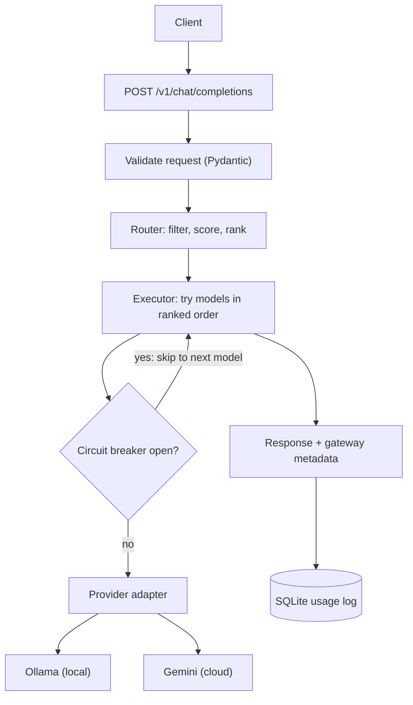

# RouteGuard: AI Gateway

A reusable AI gateway built with FastAPI. Applications call **one endpoint in one format**, and the gateway decides which LLM answers, based on task type, cost, latency, and availability. If a model fails, it falls back to the next one automatically, and it records usage, cost, and latency for every request.

## Why a gateway?

Calling a provider directly ties an app to one vendor's format, price, and uptime. A gateway sits in the middle and solves four problems:

| Problem | How the gateway handles it |
|---|---|
| A provider has an outage or rate-limits you | Retries once, then falls back to the next ranked model |
| Every provider uses a different request and response format | One common API; a small adapter per provider translates |
| Easy tasks don't need the most expensive model | Routing rules in config rank models per task type |
| Nobody knows what AI usage costs | Every request is logged with tokens, cost, latency, and fallback trail |

## Features

- **Common API.** One OpenAI-style chat endpoint, validated with Pydantic.
- **Multiple providers and models.** Ollama (local) and Google Gemini, behind a shared adapter interface.
- **Configurable routing.** Models, strategies, and routes live in `models.yaml`. No code change to add a model or change a price.
- **Automatic fallback.** Ranked candidate list; temporary failures move to the next model, bad requests stop immediately.
- **Retry with backoff and jitter.** One quick retry per model, honouring `Retry-After`.
- **Circuit breaker per model.** A model that keeps failing is skipped for a cooldown, then probed with a single request.
- **Latency learning.** A running average (EWMA) of measured latency feeds back into the router.
- **Usage logging.** One row per request in SQLite, written in the background so users never wait for it.

## Architecture



### Life of a request

1. **Validate.** Bad input is rejected with a 422 before any model is called.
2. **Route.** Filter out models that cannot serve the task or fit the prompt, score the rest, and sort them into a ranked list.
3. **Execute.** Try the best model. Skip it if its circuit breaker is open. On a temporary failure, retry once, then move to the next model. On a bad request, stop.
4. **Respond.** Return the answer plus which model answered, the latency, and the fallback trail.
5. **Learn and log.** Update the model's latency average and write a usage row in the background.


## Setup

**Requirements:** Python 3.11 or newer. [Ollama](https://ollama.com) for local models. A Gemini API key is optional.


## Configuration

Everything about models and routing lives in `models.yaml`.

```yaml
models:
  - id: cloud-gemini            # the gateway's own nickname for the model
    provider: gemini            # which adapter to use
    model: gemini-3.1-flash-lite  # the provider's model name (these change often)
    tasks: [chat, summarization, code, translation]
    cost_per_1m_input: 0        # price per million tokens
    cost_per_1m_output: 0
    max_context: 100000
    timeout_s: 30
    quality: 9                  # manual 1-10 rating

strategies:                     # named sets of weights
  cheapest: { cost: 0.7, latency: 0.2, quality: 0.1 }
  fastest:  { cost: 0.1, latency: 0.7, quality: 0.2 }
  quality:  { cost: 0.1, latency: 0.1, quality: 0.8 }
  balanced: { cost: 0.3, latency: 0.3, quality: 0.4 }

routes:                         # task type -> strategy
  chat: fastest
  code: quality
  default: balanced
```

Changing a price, a timeout, or a routing rule is a one-line edit. The file is validated at startup, so a typo (`timeout_s: abc`, a duplicate `id`, or a route that points at an unknown strategy) stops the app with a clear message and never fails in the middle of a request.

### How routing decides

1. **Filter (hard rules).** A model is removed if it does not list the task type, or if the estimated prompt size (about 4 characters per token, plus `max_tokens`) exceeds its `max_context`.
2. **Score (soft preferences).** Each remaining model gets three scores from 0 to 1, where 1 is best:
   - cost: `1 - cost / most_expensive_candidate` (1.0 if all candidates are free)
   - speed: `fastest_measured_latency / this_model_latency` (a neutral 0.5 until the model has been measured)
   - quality: `quality / 10`

   The final score is the weighted sum using the task's strategy.
3. **Order.** Sort by score. The result is the ranked list, and everything after position 1 is the fallback chain.

## Reliability

| Situation | Class | What the gateway does |
|---|---|---|
| Timeout or connection error | Retryable | Retry the same model once, then the next model |
| 429 or 5xx from the provider | Retryable | Same. Honours `Retry-After` up to 5 seconds, otherwise falls back immediately |
| Other 4xx from the provider (bad request, bad key) | Non-retryable | Stop and return the error. Another model would not help |
| No model supports the task or the prompt is too large | n/a | 422 |
| Every candidate failed | n/a | 503 with the full attempts trail in the body |

**Circuit breaker.** One per model. After 3 consecutive failed requests it opens and the model is skipped instantly for 30 seconds, so users stop paying for timeouts on a model that is down. After the cooldown, a single request is let through as a probe. Success closes the breaker, failure reopens it. Only retryable errors count, so a caller's bad request never trips a breaker.

**Latency learning.** After each successful call, the model's latency average is updated: `new = 0.3 * sample + 0.7 * old`. One slow request nudges the average instead of replacing it.

## API

| Endpoint | Purpose |
|---|---|
| `POST /v1/chat/completions` | Send a chat request to the gateway |
| `GET /v1/models` | Models the gateway has loaded |
| `GET /v1/usage?days=7` | Usage summary: requests, failures, fallbacks, cost, tokens, latency, per-model and per-task breakdowns |
| `GET /v1/latency` | Current latency averages |
| `GET /v1/breakers` | Circuit breaker state per model |
| `GET /health` | Liveness check |

Example request:

```json
{
  "messages": [
    {"role": "system", "content": "Answer briefly."},
    {"role": "user", "content": "What is the capital of France?"}
  ],
  "max_tokens": 200,
  "task_type": "chat"
}
```

`task_type` is the gateway's own extra field, and it defaults to `chat`. It is lowercased and trimmed on input.

Example response (values are illustrative):

```json
{
  "id": "req_29acbd8b53cb",
  "content": "The capital of France is Paris.",
  "usage": {"input_tokens": 20, "output_tokens": 8},
  "gateway": {
    "model_used": "cloud-gemini",
    "latency_ms": 1200.5,
    "fallback_used": false,
    "attempts": [],
    "finish_reason": "stop"
  }
}
```

`attempts` lists the models that failed before the one that answered (for example `["cloud-gemini: gemini unreachable: ReadTimeout"]`), and `finish_reason` is `length` when the answer was cut off by the token limit.

## Usage logging

Each request writes one row to `usage.db` (SQLite): timestamp, task type, model used, attempts trail, input and output tokens, cost, total latency, status, and error type. Failed requests are logged too. Prompts and answers are **not** stored, because they may contain private data.

Logging runs as a background task after the response is sent, and a logging failure never breaks a user's request.

`latency_ms` in the log is the time the caller waited for the whole request, including failed attempts and fallback. `gateway.latency_ms` in the response is the time of the one successful provider call, which is what the router compares.

## Verification

The behaviour was checked in two ways:

- **Scripts with fake adapters** (`tests/scratch_*.py`) simulate outages, rate limits, slow responses, and bad requests, and print the resulting trail and call counts. Run them from the project root, for example `python -m tests.scratch_executor`.
- **Live failure tests** against real providers:
  - Ollama stopped: clean 503 with a trail naming every model tried.
  - Cloud model timeout, 429, and 503: fell back to a local model, and the response reported the failure in `attempts`.
  - Wrong API key: surfaced as an error with no fallback, and the breaker stayed closed.
  - Repeated timeouts: the breaker opened after three failures and the model was skipped.

On the author's laptop (CPU only), the cloud model wrote about 500 tokens in roughly 7 seconds, while a 2B local model needed roughly 50 seconds for about 400 tokens. These numbers depend on hardware and provider load, but they show why measured latency belongs in the routing decision.


## Tech stack

Python, FastAPI, Pydantic v2, pydantic-settings, httpx (async), aiosqlite, PyYAML, Ollama, Google Gemini API.